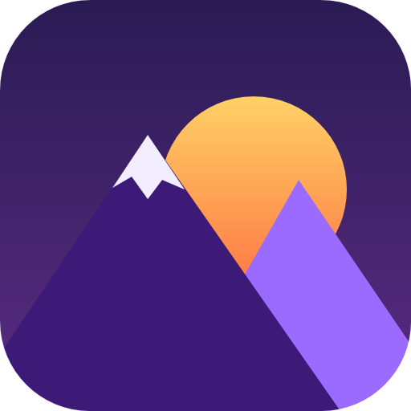

# BLVD — releases

> [!WARNING]
> BLVD is still in testing: expect bugs, and many fixes are on the way. Please report problems in the
> [issues](https://github.com/EchoRPgm/BLVD-Releases/issues) — it helps a lot.

Downloads of **BLVD**, a free Windows tool for Source engine games and mods: it edits textures (VTF) and materials
(VMT), converts images in batches, turns 3D models, images and text into Garry's Mod props, and checks what a map
needs. This repository only holds the published versions. Guide and website: https://donosonion.github.io/blvd/

<!-- downloads:start -->
## Latest version: [v1.5.0](https://github.com/EchoRPgm/BLVD-Releases/releases/tag/v1.5.0)

| Download | |
|---|---|
| [BLVD-win-x64.zip](https://github.com/EchoRPgm/BLVD-Releases/releases/download/v1.5.0/BLVD-win-x64.zip) | **Recommended.** Windows 10/11 x64, nothing to install. |
| [BLVD-win-x64-fx.zip](https://github.com/EchoRPgm/BLVD-Releases/releases/download/v1.5.0/BLVD-win-x64-fx.zip) | Smaller; needs the .NET 8 Desktop Runtime. |
| [SHA256SUMS.txt](https://github.com/EchoRPgm/BLVD-Releases/releases/download/v1.5.0/SHA256SUMS.txt) | Checksums. |
<!-- downloads:end -->

All versions: [Releases](https://github.com/EchoRPgm/BLVD-Releases/releases).

## Installing

1. Download `BLVD-win-x64.zip` (runs without installing anything) or `BLVD-win-x64-fx.zip` (smaller; needs the
   [.NET 8 Desktop Runtime](https://dotnet.microsoft.com/download/dotnet/8.0)).
2. If you like, check the download against the release's `SHA256SUMS.txt`:
   `Get-FileHash .\BLVD-win-x64.zip -Algorithm SHA256`.
3. Unzip it into a folder and open `BLVD.exe`. The package has 10 files: `BLVD.exe`, five native libraries, the
   licences, a readme and `Guide.html`.

BLVD tells you when a new version is out, and **Update now** installs it (Settings › Updates). The interface is in
English, with Brazilian Portuguese available in Settings › Language.

## What it does

- **Viewer:** VTF textures in tabs — channels, transparency, frames, faces, mipmaps, animation, HDR; properties, flags
  and resources; export and paste with alpha; rotate, flip, resize, invert normal-map green, regenerate mipmaps,
  generate a normal map from the colours.
- **Material:** a VMT editor with validation, a form with a live preview, and a 3D preview of the material.
- **Convert:** images and folders (PNG, JPG, TGA, WebP, SVG…) to VTF + VMT, with linked normal/specular maps,
  animated textures, generated normal maps, a watch mode and a history.
- **Model:** FBX, glTF, OBJ, DAE and more → Garry's Mod props, without Blender: size and orientation, collision fitted
  to the shape, LODs, skins, static or physics props. **From image / From text** turn logos and words into 3D signs,
  optionally glowing.
- **Props:** a library of the props you compiled.
- **Map:** what a `.bsp`/`.vmf` uses, what is missing and what must ship with it; copy the custom content to an addon
  or pack it into the map.
- **Explorer integration:** *Open with BLVD*, *Convert to VTF* and `.vtf` thumbnails.

## Problems and suggestions

Open an [issue](https://github.com/EchoRPgm/BLVD-Releases/issues) with the version (Settings › About) and the steps to
reproduce it.

## Licence and source code

BLVD is distributed under the [GNU GPL version 2](GPL.txt) and BLVDLib under the [GNU LGPL version 2.1](LGPL.txt).
Credits: BLVDLib, BLVDThumbnail and BLVDCmd derive from VTFLib, VTFEdit and VTFCmd by Neil "Jed" Jedrzejewski and
Ryan Gregg, with contributions from misyltoad, Sky-rym and IAmKnotMax.

Under section 3(b) of the GPL v2, the source code of every version published here can be requested by opening an
issue in this repository, for at least three years from that version's publication, at no cost beyond shipping.
